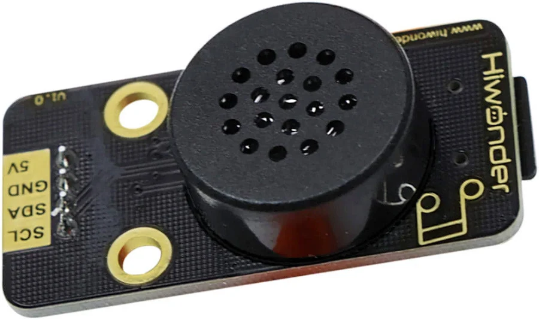
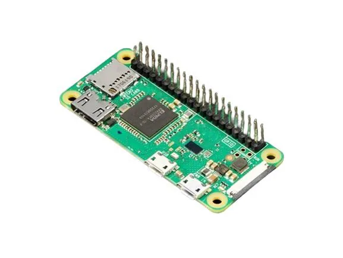
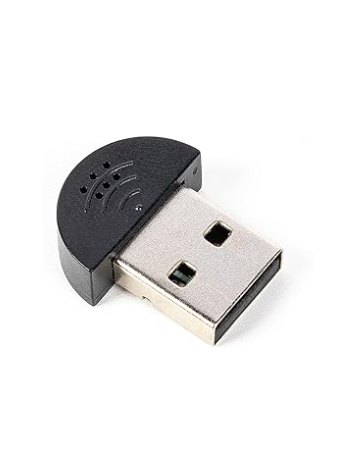
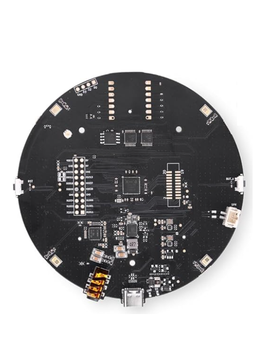

# Claudia

Build your own Claude-powered voice assistant in an afternoon: a Raspberry Pi Zero 2 WH, a hardware wake-word module, a USB mic and a USB speaker, about $101 in parts. No soldering, no Alexa account, no subscription.

    



Version 2.0.0. Try it: order the parts below, flash Raspberry Pi OS, then run the installer or follow the guide step by step. You need a [Claude API key](https://console.anthropic.com).

## Why

- Talk to Claude out loud: say "Claudia", ask a question, and hear the answer in seconds.
- Own the whole device. No Alexa or Google account, no always-on cloud microphone, no subscription; you pay only for the API calls you make.
- Assemble it in a few minutes with four jumper wires and two USB plugs. No soldering iron.
- Keep wake-word detection private: it runs on the WonderEcho chip itself, so nothing is recorded until you say the word.
- Speech recognition and the voice run on the Pi by default (Vosk and Piper). Only your question text goes to Claude. OpenAI and ElevenLabs are opt-in upgrades for speed and voice quality.
- Switch real lights with your voice using local-control smart plugs, with no vendor cloud in the loop.

## Features

- Hardware wake word: the Hiwonder WonderEcho learns "Claudia" by voice and reports each detection over I²C.
- A small bridge script (`scripts/pi/wonderecho-wake.py`) feeds those detections to the chatbot through its own wake-word setting, so upstream code is never edited.
- Conversation audio from a USB mic (the SunFounder mini mic, or the Seeed reSpeaker XVF3800 4-mic array for far-field pickup) and replies through a USB speaker.
- Claude as the brain, through the open-source [PiSugar whisplay-ai-chatbot](https://github.com/PiSugar/whisplay-ai-chatbot) runtime, cloned onto the Pi at build time.
- Swappable speech-to-text (local Vosk, or OpenAI) and text-to-speech (local Piper, OpenAI gpt-4o-mini-tts, or ElevenLabs through a drop-in plugin).
- Optional PiSugar 3 battery for a portable build, optional 3D-printed case, optional smart plugs (TP-Link Kasa, Shelly, Sonoff with Tasmota) that Claude switches through a drop-in tool plugin.
- An idempotent Pi installer (`scripts/pi/install-claudia.sh`) that automates the system setup, audio config, local speech engines, install and boot-service steps.
- A five-part healthcheck (`scripts/pi/healthcheck.sh`): WonderEcho on I²C, USB mic and speaker in ALSA, the wake bridge, network to Anthropic, and a real Claude API call.
- Starts on boot as a systemd service and ends each conversation after 60 seconds of silence or a stop word.

## Parts list

Prices are approximate USD retail as of 2026-06-09; the OTG hub and USB speaker were added and priced on 2026-10-24. These tables are static: they are written by hand from [config/parts.json](config/parts.json) and updated by hand when the catalog changes. Check current prices before you order. Buy links follow the catalog's priority order (Amazon, then official store, then reputable sellers).

### Core parts

Required for every build.

| Part | Qty | Unit price | Buy |
| --- | --- | --- | --- |
| Raspberry Pi Zero 2 WH | 1 | $20 | [amazon.com](https://www.amazon.com/s?k=raspberry+pi+zero+2+wh+headers&i=electronics&s=price-asc-rank) |
| microSD card, 32 GB Class 10 (SanDisk Ultra) | 1 | $9 | [amazon.com](https://www.amazon.com/s?k=sandisk+ultra+32gb+microsd&i=electronics&s=price-asc-rank) |
| Official Raspberry Pi 12.5W micro-USB power supply (5V/2.5A) | 1 | $9 | [amazon.com](https://www.amazon.com/s?k=official+raspberry+pi+power+supply+12.5W+micro+usb&s=price-asc-rank) |
| micro-USB OTG hub, 3-4 port, USB-only (no Ethernet) | 1 | $10 | [amazon.com](https://www.amazon.com/s?k=micro+usb+otg+hub+4+port&i=electronics&s=price-asc-rank) |
| Adafruit Mini External USB Stereo Speaker (3369) | 1 | $13 | [adafruit.com](https://www.adafruit.com/product/3369) |
| Hiwonder WonderEcho voice module (I2C wake-word frontend) | 1 | $24 | [amazon.com](https://www.amazon.com/dp/B0F7RR983M) |
| ELEGOO 120pcs Dupont Jumper Wire Kit (M-F / M-M / F-F) | 1 | $7 | [amazon.com](https://www.amazon.com/dp/B01EV70C78) |
| **Core total** | | **$92** | |

### Conversation microphone

Required: pick one. The WonderEcho only handles the wake word; it never streams audio to the Pi.

| Part | Qty | Unit price | Buy |
| --- | --- | --- | --- |
| SunFounder USB 2.0 Mini Microphone (default) | 1 | $9 | [amazon.com](https://www.amazon.com/SunFounder-Microphone-Raspberry-Recognition-Software/dp/B01KLRBHGM) |
| Seeed reSpeaker XVF3800 USB 4-Mic Array (far-field upgrade) | 1 | $51 | [amazon.com](https://www.amazon.com/ReSpeaker-Microphone-Cancellation-Far-Field-Assistants/dp/B0FKGFXQQ5) |

Default build total, core plus the SunFounder mic: **$101**. With the reSpeaker array instead: **$143**.

### Optional battery

| Part | Qty | Unit price | Buy |
| --- | --- | --- | --- |
| PiSugar 3 1200 mAh battery | 1 | $40 | [amazon.com](https://www.amazon.com/s?k=pisugar+3+1200&i=electronics&s=price-asc-rank) |

### Optional smart plugs

Pick one if you want voice control of a lamp or appliance without a cloud round trip beyond Claude itself.

| Part | Qty | Unit price | Buy |
| --- | --- | --- | --- |
| TP-Link Kasa HS103 / KP125M smart plug (local control via python-kasa) | 1 | $10 | [amazon.com](https://www.amazon.com/s?k=tp-link+kasa+hs103+smart+plug&s=price-asc-rank) |
| Shelly Plug US (local HTTP / MQTT, no cloud required) | 1 | $20 | [amazon.com](https://www.amazon.com/s?k=shelly+plug+us+gen4&s=price-asc-rank) |
| Sonoff S31 (re-flashable with Tasmota for local MQTT control) | 1 | $10 | [amazon.com](https://www.amazon.com/s?k=sonoff+s31&s=price-asc-rank) |

### Part photos

| Pi Zero 2 WH | SunFounder mini mic | reSpeaker XVF3800 array |
| --- | --- | --- |
|  |  |  |

All part photos are in [config/images](config/images).

### Before you start

- WH, not W. The WonderEcho connects to four GPIO pins (SDA, SCL, 5V, GND), so you need the WH variant with pre-soldered headers. The plain W means soldering 40 pins yourself.
- The Pi Zero 2 WH has no audio jack and one USB data port. That is why the build has a USB speaker and an OTG hub: the mic and the speaker share the hub. The WonderEcho's own speaker plays only its firmware phrases, never Claude's replies.
- Buy a USB-only OTG hub. Hubs with an Ethernet port draw about 280 mA even when the Ethernet is unused, and pogo-pin hubs that mount under the Pi collide with the PiSugar 3.
- A Windows, macOS or Linux computer to flash the microSD and SSH in, and a way to plug in a microSD card. The SanDisk Ultra ships with a full-size SD adapter but no USB reader; most modern ultrabooks and MacBooks need a USB microSD reader (about $8).
- A 2.4 GHz Wi-Fi network. The Pi Zero 2 WH has no 5 GHz radio.
- Four female-to-female jumper wires to link the WonderEcho to the Pi. The WonderEcho includes no cable; the Dupont kit above covers it.
- A multimeter, if you have one, for a 30-second safety check on the WonderEcho before wiring (see Assemble).
- The smart plugs above are US plugs. Kasa, Shelly and Sonoff also sell EU, UK and AU variants that speak the same local API.
- Stock check: the Pi Zero 2 WH is supply-constrained. If every US retailer is out of stock, [rpilocator.com](https://rpilocator.com) tracks live availability across official resellers.

## Quick start

1. Order the core parts and one microphone.
2. Teach the WonderEcho the word "Claudia" (see Teach the WonderEcho "Claudia"). It takes a minute and needs only a USB-C cable.
3. Wire the WonderEcho to the Pi with four jumpers, and plug the OTG hub into the middle `USB` port with the mic and speaker in the hub (see Assemble).
4. Flash Raspberry Pi OS 64-bit with hostname `claudia`, SSH and Wi-Fi enabled (see Flash the microSD), then boot the Pi.
5. Copy the three Pi scripts over and run the installer from your computer, as shown below. It stops once and asks for your Claude API key.
6. Put your key in `~/whisplay-ai-chatbot/.env` (see Configure the chatbot) and run the installer again. It finishes with the healthcheck; you should see green check marks in all five sections.
7. Say "Claudia" and ask a question. Claude answers out loud.

```bash
scp scripts/pi/install-claudia.sh scripts/pi/healthcheck.sh scripts/pi/wonderecho-wake.py <your-username>@claudia.local:~
ssh -t <your-username>@claudia.local 'bash ~/install-claudia.sh'
```

The installer is idempotent: it updates the system, switches the Pi to console boot and trims unused services, installs build dependencies, enables I²C, finds your USB mic and speaker and writes `~/.asoundrc` if absent, clones and builds `whisplay-ai-chatbot`, writes Claudia's settings into the chatbot's `.env`, installs the wake bridge and the local speech engines (Vosk and Piper), refuses to continue with a placeholder `ANTHROPIC_API_KEY`, runs the healthcheck and registers the `chatbot.service` boot unit. Safe to re-run; on a re-run it only adds `.env` keys that are missing and never overwrites your choices. The manual steps follow.

## How it works

The WonderEcho is a command-word recognizer, not a microphone. Its CI1302 chip recognizes the wake word on-device and puts a one-byte result in an I²C register. It never streams raw audio, so nothing can transcribe through it. The chatbot's wake-word listener normally runs openWakeWord on the mic; Claudia points that listener at `wonderecho-wake.py` instead, which polls the WonderEcho's result register and prints `WAKE` when the word is heard. The chatbot then records your question from the USB mic, transcribes it, sends the text to Claude, and speaks the reply on the USB speaker.

```text
  This repo (Claudia)                           On the Pi (after following the guide)
  +---------------------------+                 +-----------------------------------------+
  | README.md (build guide)   | builder follows | Raspberry Pi OS 64-bit                  |
  | config/parts.json         | --------------> |  whisplay-ai-chatbot (cloned upstream)  |
  | config/env.template       |                 |   wake listener -> ~/claudia/           |
  | config/asoundrc.usbmic    |                 |     wonderecho-wake.py (I2C poll)       |
  | scripts/pi/*.sh, *.py     |                 |   ASR (Vosk) > Claude > TTS (Piper)     |
  | plugins/ (drop-ins)       |                 |   systemd chatbot.service               |
  | docs/ (Codex canon)       |                 +------+--------------+-----------+-------+
  +---------------------------+                        | I2C (4 wires)| USB (OTG hub)
                                                       v              v
                                          WonderEcho (0x34)     USB mic + USB speaker
                                          hears "Claudia"       your question, Claude's voice
                                                                      |
                                                                      v HTTPS (text only)
                                                            api.anthropic.com (Claude)
```

Only the Claude API call is mandatory cloud traffic, and with the default local speech engines it carries text, not audio. Speech-to-text, text-to-speech and smart-home control each have a local option, and the local option is the default.

| Layer | What it is |
| --- | --- |
| Hardware | Pi Zero 2 WH, OTG hub, USB mic (SunFounder mini or reSpeaker XVF3800), USB speaker, Hiwonder WonderEcho (I²C wake word), optional PiSugar 3 battery |
| OS | Raspberry Pi OS 64-bit, booting to the console |
| Wake word | "Claudia", learned by and detected on the WonderEcho; `wonderecho-wake.py` relays it to the chatbot |
| Microphone and speaker | USB devices behind the OTG hub, made the ALSA default by `~/.asoundrc` |
| Speech to text | Vosk (local, default) or OpenAI (cloud) |
| LLM | Claude API (Anthropic), Claude Haiku 5.5 by default |
| Text to speech | Piper (local, default), OpenAI gpt-4o-mini-tts, or ElevenLabs (plugin) |
| Service manager | systemd (`chatbot.service`, set up by upstream's `startup.sh`) |

## Build options

The catalog defines six choices in `configAxes` inside [config/parts.json](config/parts.json). The guide marks where each one changes a step. The speech options are the chatbot's `ASR_SERVER` and `TTS_SERVER` values.

| Choice | Options | Default |
| --- | --- | --- |
| Battery | No (desktop, wall-powered), Yes (PiSugar 3, portable) | No |
| Conversation microphone | SunFounder USB mini mic, reSpeaker XVF3800 4-mic array | SunFounder |
| Speech to text | Vosk (local, free), OpenAI (cloud) | Vosk |
| Text to speech | Piper (local, free), OpenAI gpt-4o-mini-tts (cloud), ElevenLabs (cloud, plugin) | Piper |
| 3D-printed case | None, FDM (filament), SLA (resin) | None |
| Smart-home control | None, TP-Link Kasa, Shelly Plug US, Sonoff S31 with Tasmota | None |

The upstream chatbot also offers `whisper` and `faster-whisper` speech-to-text, but they need far more than the Pi Zero 2 WH's 512 MB of RAM, so this guide leaves them out.

## Teach the WonderEcho "Claudia"

Do this once, before wiring, with the module powered from any USB charger or computer through its USB-C port. It uses the factory firmware's voice-learning mode ([Hiwonder: Modify Wake-up and Command Words](https://docs.hiwonder.com/projects/WonderEcho/en/latest/docs/3_Modify_Wake_up_and_Command_Words.html)):

1. In a quiet room, within about a metre of the module, say "Hello Hiwonder". Wait for it to answer "I'm here".
2. Say "study wake". Wait for "please say command".
3. Say "Claudia", clearly and at a normal pace. Wait for "learning succeed".
4. Test it: say "Claudia". The blue LED blinks once each time the module recognizes a word.

"Hello Hiwonder" stays active alongside "Claudia"; the factory firmware does not let you delete it. Voice learning works only with the factory firmware, so do not flash custom firmware if you want to keep it.

## Assemble

Total time is about 5 minutes. No soldering.

1. Do not insert the microSD yet. You flash it in the next stage.
2. Safety check (30 seconds, needs a multimeter). The WonderEcho runs from 5 V, and Hiwonder does not publish the voltage its SDA and SCL lines idle at. The Pi's GPIO pins tolerate 3.3 V at most. With the module still powered over USB-C and not wired to anything, measure from GND to SDA and from GND to SCL. 3.3 V or less (or near 0 V) is safe to wire. If either reads above 3.6 V, stop and put a bidirectional I²C level shifter between the module and the Pi. Hiwonder's own Raspberry Pi tutorial wires the module straight to the Pi, so you should see the safe reading. Unplug the USB-C cable when done; the module is powered from the Pi from here on.
3. Connect the WonderEcho to the Pi's I²C header with 4 female-to-female Dupont jumper wires: `SDA → BCM 2 (pin 3)`, `SCL → BCM 3 (pin 5)`, `5V → pin 2`, `GND → pin 6`.
4. Plug the OTG hub into the Pi's middle port labelled `USB` (the data port, not the corner `PWR IN` port). Plug the USB microphone and the USB speaker into the hub.
5. Position the mic and speaker. The SunFounder mini mic is a thumb-size dongle; point its grille toward where you will speak. The reSpeaker XVF3800 array sits flat with its mics facing the room (its beamforming works best with an unobstructed 360° view) and connects to the hub with its own USB cable. Point the speaker away from the mic so replies do not drown out the next question.
6. Make sure the WonderEcho's microphone is unobstructed; it listens for the wake word.
7. Battery build only: snap the PiSugar 3 onto the underside of the Pi with its magnetic, spring-loaded pogo pins. It uses I²C addresses 0x57 and 0x68, so it shares bus 1 with the WonderEcho (0x34) without conflict. A USB speaker at high volume drains the 1200 mAh cell quickly; keep the volume moderate.

reSpeaker alternative: the XVF3800 array has its own 3.5 mm jack and JST speaker connector. If you attach a speaker there, you can skip the USB speaker and plug the array straight into a plain micro-USB OTG adapter instead of the hub.

Checkpoint: the four I²C wires are seated firmly, the hub is in the middle `USB` port with the mic and speaker in it, and the WonderEcho's mic is unobstructed.

## Flash the microSD

If your laptop has no SD-card slot, plug in a USB microSD reader now.

Download Raspberry Pi Imager from raspberrypi.com/software (Windows, macOS, Linux), then:

1. Open Raspberry Pi Imager.
2. Choose Device: `Raspberry Pi Zero 2 W`. Imager does not distinguish W from WH; the OS image is the same.
3. Choose OS: `Raspberry Pi OS (other)`, then Raspberry Pi OS (64-bit). The installer switches the Pi to console boot, so the desktop never uses RAM.
4. Choose Storage: your microSD card.
5. Open the OS customisation settings and set the options listed below.
6. Save, then Write. It takes 2 to 5 minutes.

OS customisation:

- Hostname: `claudia`
- Username: anything other than `pi`. Pi OS Bookworm deprecated the default `pi` user and current Imager builds warn or refuse.
- Password: something secure
- Enable SSH with password authentication
- Wireless LAN: your home Wi-Fi SSID and password
- Locale: your timezone (for example `America/Chicago`) and keyboard layout (for example `us`)

### First boot

1. Insert the microSD into the Pi.
2. Plug the official power supply into the `PWR IN` micro-USB port (nearest the corner). Not the middle `USB` port.
3. Wait 60 to 90 seconds.
4. SSH in from your computer. If `claudia.local` does not resolve, find the Pi's IP in your router's admin page and use that instead.

```bash
ssh <your-username>@claudia.local
```

Checkpoint: you see the `<your-username>@claudia:~ $` prompt. `cat /etc/os-release` says Debian/Raspberry Pi OS, and `free -h` shows about 430 MB of `Mem:` (the Pi Zero 2 WH has 512 MB).

## System setup

Run these from the SSH session, one at a time. The installer does all of this for you.

### Update

This takes 5 to 15 minutes on a Pi Zero 2 WH.

```bash
sudo apt update && sudo apt full-upgrade -y
```

### Free up RAM

The Pi Zero 2 WH has only 512 MB. Boot to the console instead of the desktop, and disable services this build does not use:

```bash
# Console boot (saves roughly 100 MB; takes effect on the next boot)
sudo systemctl set-default multi-user.target

# Bluetooth and the gamepad daemon are not used by this build
sudo systemctl disable hciuart bluetooth triggerhappy
```

### Install build dependencies

```bash
sudo apt install -y git curl unzip build-essential python3-pip python3-venv \
  portaudio19-dev libsndfile1 ffmpeg sox alsa-utils i2c-tools python3-smbus
```

On a Bookworm-based image you can also `sudo apt install -y libatlas-base-dev`; the package no longer exists on Trixie-based Raspberry Pi OS, so leave it out there.

### Enable I2C and detect the WonderEcho

```bash
sudo raspi-config nonint do_i2c 0
i2cdetect -y 1
```

Checkpoint: the grid shows `34` in the `30:` row. That is the WonderEcho's documented address ([Hiwonder: Multiple Controller Communication](https://docs.hiwonder.com/projects/WonderEcho/en/latest/docs/4_Multiple_Controller_Communication_Tutorial.html)); a unit that was re-addressed shows `33`. If the grid is empty, recheck the four wires, then reboot once and try again.

### Set up the mic and speaker

Both are USB Audio Class devices, so no driver is needed. Confirm ALSA sees them:

```bash
arecord -l   # capture devices: your mic
aplay -l     # playback devices: your speaker (ignore the vc4hdmi entries)
```

Each line starts `card N: ID [...]`. Note the ID of the mic in `arecord -l` and of the speaker in `aplay -l`; for example the SunFounder mic usually shows as `Device`. Make them the default devices so the chatbot finds them:

```bash
nano ~/.asoundrc
```

Paste the following, replacing `MIC` and `SPEAKER` with those IDs. The same file ships in this repo as [config/asoundrc.usbmic](config/asoundrc.usbmic).

```text
pcm.!default {
    type asym
    playback.pcm "plughw:CARD=SPEAKER,DEV=0"
    capture.pcm "plughw:CARD=MIC,DEV=0"
}

ctl.!default {
    type hw
    card SPEAKER
}
```

Card IDs, unlike card numbers, stay the same when the USB devices come up in a different order after a reboot. On the reSpeaker array with a speaker on its jack, `MIC` and `SPEAKER` are the same ID.

Record a 3-second test clip and play it back:

```bash
arecord -d 3 -f S16_LE -r 16000 /tmp/mictest.wav
aplay /tmp/mictest.wav
```

Checkpoint: you hear your own voice from the speaker. If the playback is quiet, run `alsamixer`, press F6, pick the speaker's card and raise the level.

## Install the chatbot

The runtime is PiSugar's `whisplay-ai-chatbot`. Claudia uses it as the speech and LLM plumbing without the Whisplay HAT itself: the WonderEcho supplies wake events, and the USB mic and speaker supply the audio.

```bash
cd ~
git clone https://github.com/PiSugar/whisplay-ai-chatbot.git
cd whisplay-ai-chatbot
bash install_dependencies.sh
source ~/.bashrc
```

The dependency install pulls Node.js (through nvm), Python packages and audio libraries and takes 15 to 25 minutes. The `source ~/.bashrc` line matters: the installer adds the nvm lines that put `node` on your PATH there.

Checkpoint: `install_dependencies.sh` finishes without errors and `node --version` prints `v20.x`.

## Get an API key

1. Go to console.anthropic.com and sign in or create an account.
2. Add a payment method and a small amount of credit (for example $5).
3. Open API Keys and click Create Key.
4. Name it `claudia` and copy the key now; you cannot see it again.
5. Treat the key like a password.

On `claude-haiku-5-5`, casual personal use typically costs well under a dollar a month. Check current pricing at anthropic.com/pricing.

### Which model to pick

| Model ID | Speed | Quality | When to use |
| --- | --- | --- | --- |
| `claude-haiku-5-5` | Fastest | Good | Default for this device. Latency matters more than essay-grade prose for a voice assistant. |
| `claude-sonnet-5-5` | Medium | Excellent | Richer answers if you do not mind a slower response. |
| `claude-opus-5-5` | Slowest | Best | Overkill for spoken Q&A. Use for hard reasoning only. |

Model IDs change over time. The current list is at [platform.claude.com](https://platform.claude.com/docs/en/about-claude/models/overview).

## Configure the chatbot

### Create your env file

The installer writes all of this for you; edit by hand only if you set up without it.

```bash
cd ~/whisplay-ai-chatbot
cp .env.template .env
nano .env
```

The upstream template has fields for many providers, and several of its values are placeholders (`LLM_SERVER=test`, `PIPER_BINARY_PATH=/path/to/piper-binary`). Set these keys, replacing `YOUR-USER` with your Pi username (`.env` files do not expand `~`):

```env
# === LLM (the AI brain) ===
LLM_SERVER=anthropic
ANTHROPIC_API_KEY=sk-ant-YOUR-KEY-HERE
ANTHROPIC_LLM_MODEL=claude-haiku-5-5
ANTHROPIC_MAX_TOKENS=2048
SYSTEM_PROMPT="You are Claudia, a concise, friendly voice assistant. Keep answers to one to three spoken sentences unless asked for more."

# === Wake word: the WonderEcho, through Claudia's bridge ===
WAKE_WORD_ENABLED=true
WAKE_WORD_PYTHON_PATH=/home/YOUR-USER/claudia/wonderecho-wake.py

# === Audio: the USB mic and speaker set up in ~/.asoundrc ===
ALSA_INPUT_DEVICE=default
ALSA_OUTPUT_DEVICE=default
```

The full example, with the speech settings below, ships in this repo as [config/env.template](config/env.template).

The model key is `ANTHROPIC_LLM_MODEL`. With it unset, upstream falls back to its own default, a much larger and slower model. Leave `ENABLE_THINKING` unset: upstream sends a fixed thinking budget with it, which current Claude models reject.

Copy the bridge into place if you are not using the installer:

```bash
mkdir -p ~/claudia
install -m 755 ~/wonderecho-wake.py ~/claudia/wonderecho-wake.py
```

Upstream names the provider keys `LLM_SERVER`, `ASR_SERVER` and `TTS_SERVER`, and its plugin registry switches on the lowercase value (see `src/cloud-api/server.ts` upstream). The `.env.template` evolves; if yours differs from this guide, the [live template](https://github.com/PiSugar/whisplay-ai-chatbot/blob/master/.env.template) is the source of truth.

Save with `Ctrl+X`, `Y`, `Enter`.

### Speech to text options

Vosk, local (default): free, offline, and small enough for 512 MB. Expect a few seconds per utterance, much of it loading the model. The installer sets it up; by hand:

```bash
python3 -m venv ~/claudia/venv
~/claudia/venv/bin/pip install vosk
# upstream runs vosk-transcriber by name, so put it on the service's PATH
sudo ln -sf ~/claudia/venv/bin/vosk-transcriber /usr/local/bin/vosk-transcriber
mkdir -p ~/claudia/models && cd ~/claudia/models
curl -fLO https://alphacephei.com/vosk/models/vosk-model-small-en-us-0.15.zip
unzip vosk-model-small-en-us-0.15.zip
```

```env
ASR_SERVER=vosk
VOSK_MODEL_PATH=/home/YOUR-USER/claudia/models/vosk-model-small-en-us-0.15
```

OpenAI (cloud): faster and more accurate, and it sends your recorded audio to OpenAI. OpenAI lists about $0.006 per minute of audio; check its current pricing. Add to `.env`:

```env
ASR_SERVER=openai
OPENAI_API_KEY=sk-REPLACE-ME
```

### Text to speech options

Piper, local (default): free, offline, clear but flat. The installer sets it up; by hand:

```bash
~/claudia/venv/bin/pip install piper-tts
mkdir -p ~/claudia/piper
~/claudia/venv/bin/python -m piper.download_voices --download-dir ~/claudia/piper en_US-amy-low
```

```env
TTS_SERVER=piper
PIPER_BINARY_PATH=/home/YOUR-USER/claudia/venv/bin/piper
PIPER_MODEL_PATH=/home/YOUR-USER/claudia/piper/en_US-amy-low.onnx
```

The `low` voices are the fastest on a Pi Zero 2 WH; [other voices](https://rhasspy.github.io/piper-samples/) download the same way.

OpenAI gpt-4o-mini-tts (cloud): supported by upstream out of the box and far more natural. Voices include `alloy`, `nova`, `onyx`, `marin`, `cedar`, `echo`, `fable`, `shimmer`, `ash`, `ballad`, `coral`, `sage` and `verse`. Roughly $0.015 per minute of speech. Add to `.env`:

```env
TTS_SERVER=openai
OPENAI_API_KEY=sk-REPLACE-ME
OPENAI_VOICE_MODEL=gpt-4o-mini-tts
OPENAI_VOICE_TYPE=nova
```

### ElevenLabs plugin

ElevenLabs has very natural voices, but upstream ships no ElevenLabs handler. Upstream does load drop-in plugins from `~/whisplay-ai-chatbot/plugins/` at startup, so Claudia ships one at [plugins/elevenlabs-tts](plugins/elevenlabs-tts/index.js). No upstream file is edited and nothing is rebuilt. From your computer:

```bash
ssh <your-username>@claudia.local 'mkdir -p ~/whisplay-ai-chatbot/plugins'
scp -r plugins/elevenlabs-tts <your-username>@claudia.local:~/whisplay-ai-chatbot/plugins/
```

Then add to `.env` and restart:

```env
TTS_SERVER=elevenlabs
ELEVENLABS_API_KEY=sk_REPLACE_ME
ELEVENLABS_VOICE_ID=EXAVITQu4vr4xnSDxMaL
ELEVENLABS_MODEL_ID=eleven_turbo_v2_5
ELEVENLABS_STABILITY=0.5
ELEVENLABS_SIMILARITY=0.75
```

```bash
sudo systemctl restart chatbot.service
```

For voice IDs, log in to [elevenlabs.io](https://elevenlabs.io), open VoiceLab and copy the ID of a cloned or stock voice. `eleven_turbo_v2_5` has the lowest latency and is recommended for the Pi Zero 2 WH. Cost is roughly $0.18 per 1000 characters (about 7 to 8 cents per minute of speech).

### Build the project

This compiles the TypeScript and prepares assets, about 5 to 10 minutes on a Pi Zero 2 WH.

```bash
bash build.sh
```

Checkpoint: `build.sh` exits cleanly with no errors.

### Check the wake bridge

Run the bridge on its own in watch mode and say "Claudia" a few times:

```bash
python3 ~/claudia/wonderecho-wake.py --watch
```

Each recognition prints a line such as `[WonderEcho] result 0x.. (..)`. Stop it with `Ctrl+C`.

Hiwonder documents the result register (`0x64`, `0x00` when nothing was heard) but not the ID a learned wake word reports, so by default the bridge wakes the chatbot on any non-zero result. Once you know which ID "Claudia" produces, you can make it the only trigger by adding it to `.env` (for example `WONDERECHO_WAKE_IDS=0x7f`; use your own value). Verify the address and register against your unit's firmware revision if nothing prints; `WONDERECHO_I2C_ADDR` changes the address the bridge polls.

Checkpoint: saying "Claudia" prints a result line, and the blue LED on the module blinks.

## Healthcheck

Before launching the full chatbot, run the healthcheck. The installer runs it too. It checks five things: the WonderEcho answers on I²C, the USB mic and speaker are visible to ALSA, the wake bridge is configured, the network reaches Anthropic, and your API key and model return a response. The full audio round trip is exercised by the manual launch in the next section.

The script is [scripts/pi/healthcheck.sh](scripts/pi/healthcheck.sh); the Quick start already copied it to the Pi. Run it:

```bash
bash ~/healthcheck.sh
```

Checkpoint: all five sections print green check marks. Fix any failure before moving on.

## Run

### Manual launch

Run in the foreground for testing:

```bash
cd ~/whisplay-ai-chatbot
bash run_chatbot.sh
```

Say "Claudia". The bridge prints `WAKE wonderecho 0x..`, the chatbot plays a short chime and records your question from the USB mic, and Claude answers through the speaker. Keep talking without the wake word; the conversation ends after 60 seconds of silence or when you say a stop word (`byebye`, `goodbye` or `stop`). Stop the process with `Ctrl+C`.

### Start on boot

Upstream's startup script registers a `chatbot.service` systemd unit. It asks whether to switch to console boot unless that is already done (the installer does it):

```bash
cd ~/whisplay-ai-chatbot
bash startup.sh
```

The chatbot now starts on every boot. Verify with the command below; you should see `Active: active (running)`.

```bash
sudo systemctl status chatbot.service
```

### Live logs

```bash
tail -f ~/whisplay-ai-chatbot/chatbot.log
# or
journalctl -u chatbot.service -f
```

### Tuning wake-word reliability

Hiwonder publishes no detection-threshold register for the WonderEcho, so tuning is about the word and the room:

- Too many false wakes (TV, conversation): narrow the bridge to the one result ID "Claudia" reports (`WONDERECHO_WAKE_IDS`), and move the module away from the TV. "Hello Hiwonder" also always wakes it.
- Missed wakes (you have to say it twice): teach the word again in a quiet room, at the distance you normally speak from, and keep the module's mic uncovered.

## Smart home

If you bought a smart plug, Claude can switch it through Claudia's [smart-plugs plugin](plugins/smart-plugs/index.js), which adds one tool, `setPlug`, to the chatbot. Copy it to the Pi:

```bash
ssh <your-username>@claudia.local 'mkdir -p ~/whisplay-ai-chatbot/plugins'
scp -r plugins/smart-plugs <your-username>@claudia.local:~/whisplay-ai-chatbot/plugins/
```

List your plugs in `.env` as `name=kind:ip`, separated by commas. The kinds are `kasa`, `shelly` and `tasmota`. Give each plug a fixed IP (a DHCP reservation in your router) so it does not move.

```env
CLAUDIA_PLUGS=living room=kasa:192.168.1.42,desk lamp=shelly:192.168.1.43
```

Re-run the installer, which installs `python-kasa` if you listed a Kasa plug and restarts the service. Then say "Claudia, turn on the living room".

### TP-Link Kasa

The plugin switches Kasa plugs with the `python-kasa` CLI. To find and test a plug by hand:

```bash
~/claudia/venv/bin/kasa discover
~/claudia/venv/bin/kasa --host 192.168.1.42 on
```

The KP125M and HS103s on newer firmware use TP-Link's authenticated local protocol, which needs your TP-Link account email and password once for the local handshake. Switching still happens on your LAN. If `kasa` asks for credentials, add them to `.env`:

```env
KASA_USERNAME=you@example.com
KASA_PASSWORD=your-tp-link-password
```

### Shelly Plug US

Local HTTP, no account. Find the plug's IP in your router admin or the Shelly app, then test:

```bash
curl "http://192.168.1.43/rpc/Switch.Set?id=0&on=true"
curl "http://192.168.1.43/rpc/Switch.Set?id=0&on=false"
```

That is the Gen2-and-later RPC call the plugin uses (the current Plug US is Gen4). Gen1 Shelly plugs use `/relay/0?turn=on` instead and are not supported by the plugin.

### Sonoff S31 with Tasmota

Out of the box the S31 uses the eWeLink cloud. Reflash it with Tasmota to get a local HTTP endpoint. You need a 3.3 V USB-to-serial adapter held against the serial pads inside the case (no soldering on the S31); the S31 template is listed on templates.blakadder.com. Test:

```bash
curl "http://192.168.1.44/cm?cmnd=Power%20On"
curl "http://192.168.1.44/cm?cmnd=Power%20Off"
```

More work to flash, but you get full local control and power-usage telemetry over MQTT. Use kind `tasmota` in `CLAUDIA_PLUGS`.

## Case

PiSugar publishes free STL files for case shells:

- [pi02 Whisplay chatbot case, FDM (filament print)](https://github.com/PiSugar/suit-cases/tree/main/pisugar3-whisplay-chatbot-fdm)
- [pi02 Whisplay chatbot case, SLA (resin print)](https://github.com/PiSugar/suit-cases/tree/main/pisugar3-whisplay-chatbot)

These cases are designed for a Pi Zero with the Whisplay HAT and a PiSugar 3. They hold the Pi but not the WonderEcho, the jumpers, the hub or the speaker, so treat them as a starting point: the WonderEcho and speaker sit outside, or you remix the STL.

No printer? Upload the STL to a print service such as [JLC3DP](https://jlc3dp.com) or [Craftcloud](https://craftcloud3d.com), a few dollars shipped.

## Troubleshooting

### Nothing plays through the speaker

- The Pi Zero 2 WH has no audio jack, and the WonderEcho's speaker only plays its own firmware phrases. Replies play on the USB speaker (or the reSpeaker's jack).
- Run `aplay -l` and check the speaker is listed, then check that `~/.asoundrc` names its card ID in `playback.pcm` and `card`.
- Watch `journalctl -u chatbot.service -f` for TTS lines. If Claude replies but you hear nothing, the playback device is wrong or muted (`alsamixer`, F6 to pick the card).
- With Piper, check `PIPER_BINARY_PATH` and `PIPER_MODEL_PATH` point at files that exist.

### Mic captures silence or garbage

- Run `arecord -l`. If the USB mic is missing, reseat the hub in the middle `USB` port (the corner port is power only) and check `dmesg | tail` for USB errors.
- Check that `~/.asoundrc` uses the mic's card ID in `capture.pcm`. IDs do not change between boots; card numbers can.
- Test in isolation with `arecord -d 3 -f S16_LE -r 16000 /tmp/mictest.wav`. If this errors, the problem is ALSA config, not the chatbot.
- If the wake event never fires when you speak, that is the WonderEcho, not the mic. See WonderEcho does not respond.

### Build fails out of memory

The Pi Zero 2 WH has only 512 MB. Add swap if `build.sh` gets OOM-killed:

```bash
sudo dphys-swapfile swapoff
sudo sed -i 's/^CONF_SWAPSIZE=.*/CONF_SWAPSIZE=1024/' /etc/dphys-swapfile
sudo dphys-swapfile setup
sudo dphys-swapfile swapon
```

### Service will not start

Look for the first ERROR line; it is usually a missing `.env` key or a wrong path.

```bash
sudo systemctl status chatbot.service --no-pager
journalctl -u chatbot.service -n 60 --no-pager
```

### Claude API returns 401

The API key is invalid or expired. Copy it again from console.anthropic.com, API Keys.

### Claude API returns 400

Usually a model ID that does not exist or a setting the model rejects. Check `ANTHROPIC_LLM_MODEL` against the model list, and remove `ENABLE_THINKING` from `.env`.

### Claude API returns 429

You are rate-limited. Add credit at console.anthropic.com, Billing.

### WonderEcho does not respond

- Run `i2cdetect -y 1` and confirm `34` (or `33`) still shows up. If it does not, a jumper has come loose.
- Run `python3 ~/claudia/wonderecho-wake.py --watch` and say "Claudia". If the blue LED blinks but nothing prints, your firmware may use a different register; check the [Hiwonder docs](https://docs.hiwonder.com/projects/WonderEcho/en/latest/) for your revision. If the LED does not blink, teach the word again.
- Check `.env` has `WAKE_WORD_ENABLED=true` and `WAKE_WORD_PYTHON_PATH` pointing at the bridge, and that the bridge is executable (`ls -l ~/claudia/wonderecho-wake.py`).

### Wake word triggers on TV

Narrow the bridge to the ID "Claudia" reports (`WONDERECHO_WAKE_IDS`, see Check the wake bridge) and move the module away from the TV.

### Responses feel slow

- Use `claude-haiku-5-5`, the recommended default for this reason.
- The Pi Zero 2 WH's Wi-Fi antenna is weak. Move it closer to the router.
- Local speech is the slowest step. OpenAI speech-to-text and text-to-speech cut perceived latency a lot, at the cost of sending audio and text to OpenAI.

### SD card filling up

```bash
df -h
sudo apt clean
# clear chatbot recordings:
rm -f ~/whisplay-ai-chatbot/data/recordings/*.wav 2>/dev/null
```

## Scripts and tools

| Entry point | Runs on | Purpose |
| --- | --- | --- |
| `scripts/pi/install-claudia.sh` | Raspberry Pi (bash) | Idempotent installer for the system setup, audio config, chatbot install, `.env` defaults, wake bridge, local speech engines, healthcheck and boot service. Safe to re-run. |
| `scripts/pi/healthcheck.sh` | Raspberry Pi (bash) | Five-part smoke test: WonderEcho on I²C, USB mic and speaker in ALSA, wake bridge configured, network to `api.anthropic.com`, and a Claude API call that must return HTTP 200. |
| `scripts/pi/wonderecho-wake.py` | Raspberry Pi (python3) | The wake bridge. The chatbot runs it as its wake-word listener; it polls the WonderEcho over I²C and prints `WAKE` on a detection. `--watch` prints every result ID. |
| `plugins/elevenlabs-tts/` | Raspberry Pi (Node, inside the chatbot) | Drop-in TTS plugin adding `TTS_SERVER=elevenlabs`. |
| `plugins/smart-plugs/` | Raspberry Pi (Node, inside the chatbot) | Drop-in tool plugin that lets Claude switch Kasa, Shelly and Tasmota plugs listed in `CLAUDIA_PLUGS`. |
| `tools/codex.ps1 doctor` | Windows PowerShell 5.1 | Validates the docs: front matter, unique ids, cross-references, JSON and schema validity for the config files, catalog id uniqueness, cited paths and digest freshness. Must exit 0. |
| `tools/codex.ps1 digest` | Windows PowerShell 5.1 | Regenerates `docs/BIBLE.digest.md` from the bible, the story statuses and any pending decisions. |
| `.github/workflows/docs.yml` | GitHub Actions | Publishes this README and `docs/` to https://mindattic.github.io/Claudia/ on every push to `main`, through the shared MindAttic.Agency DocFX pipeline. |

## Configuration

| File | What it holds |
| --- | --- |
| [config/parts.json](config/parts.json) | The shopping catalog and the six build-option axes. Every part has an id, category, price, specs, buy-link tiers and an optional gate on a build option. Prices are dated estimates. Ids are mirrored in [docs/data/parts.index.json](docs/data/parts.index.json) and validated by the schema in [docs/data](docs/data). |
| [config/versions.json](config/versions.json) | Pinned upstream version labels: Node major, system Python, Raspberry Pi OS label, default Claude model, Vosk model, Piper voice. Kept in sync with this README by hand. |
| [config/env.template](config/env.template) | Example `.env` for `~/whisplay-ai-chatbot/.env`: provider keys, wake bridge, audio devices and the system prompt. The installer writes the same keys. |
| [config/asoundrc.usbmic](config/asoundrc.usbmic) | ALSA profile that makes the USB mic the default capture device and the USB speaker the default playback device, by card ID. The installer writes it with your card IDs if `~/.asoundrc` does not exist. |
| [config/images](config/images) | Part photos referenced by the catalog. |

Build-option contract: an option `key=value` is valid only if the `configAxes` block, each part's gate and this README's build-options table agree. `codex.ps1 doctor` checks that every part gate names a known axis; the README side is checked by review.

## Project layout

```text
Claudia/
  README.md                 project page and build guide (this file)
  AGENTS.md                 agent entry point
  config/
    parts.json              shopping catalog and build options
    versions.json           pinned upstream version labels
    env.template            example .env for the Pi
    asoundrc.usbmic         ALSA profile for the USB mic and speaker
    images/                 part photos
  scripts/pi/
    install-claudia.sh      idempotent Pi installer
    healthcheck.sh          five-part smoke test
    wonderecho-wake.py      WonderEcho to chatbot wake bridge
  plugins/
    elevenlabs-tts/         drop-in ElevenLabs TTS plugin
    smart-plugs/            drop-in smart-plug tool plugin
  tools/
    codex.ps1               doctor and digest
  .github/workflows/
    docs.yml                publishes the docs site to GitHub Pages
  docs/
    BIBLE.md                architecture, laws, verified state, glossary
    AMENDMENTS.md           pending decisions (normally empty)
    USER_STORIES.md         stories with their verifying checks
    BIBLE.digest.md         generated, never hand-edited
    rfc/                    open design proposals
    data/                   catalog id index and schema
```

## Testing

There is no compiler and no test runner. Build means regenerating generated files; test means these checks pass. Run from the repo root in Windows PowerShell 5.1:

```powershell
powershell -NoProfile -ExecutionPolicy Bypass -File tools/codex.ps1 digest
powershell -NoProfile -ExecutionPolicy Bypass -File tools/codex.ps1 doctor
```

Reviewed by hand, not automated:

- The Pi shell scripts are syntax-checked with `bash -n`, the bridge with Python's parser, and the plugins by loading them in Node. All are kept idempotent.
- New or edited build options are checked to agree between the axes, the part gates and this README.

## Limitations

- On-hardware behaviour (WonderEcho detection through the bridge, the wake to Claude to speech round trip, the boot service) is not exercised in CI; those stories stay partial until proven on a real Pi.
- Hiwonder does not document the result ID a learned wake word reports, or the idle voltage of the module's I²C lines. The bridge wakes on any non-zero result until you narrow it, and the Assemble safety check covers the voltage.
- The guide depends on upstream internals (the `.env` keys, the wake-listener hook, the plugin folder). Upstream can change them; its `.env.template` and source are the source of truth.
- Claude Haiku 5.5 thinks before answering by default, and upstream offers no setting to turn that down, which adds some latency to each reply.

## Documentation

- [docs/BIBLE.md](docs/BIBLE.md): what Claudia is and is not, architecture, laws, verified state, glossary
- [docs/AMENDMENTS.md](docs/AMENDMENTS.md): decisions not yet folded into the bible (normally empty)
- [User stories](docs/USER_STORIES.md): Epics A to D (configure and shop, assemble and flash, install and converse, verify and operate)
- [AGENTS.md](AGENTS.md): instructions for AI agents working in this repo

This README on GitHub is the project page; it is a static page with no build or deploy step. Releases bump the major version only (1.0.0, 2.0.0, 3.0.0).

Reference links:

- [Hiwonder WonderEcho](https://www.hiwonder.com/products/wonderecho) and its [documentation](https://docs.hiwonder.com/projects/WonderEcho/en/latest/)
- [SunFounder USB mini mic](https://www.sunfounder.com/products/mini-usb-microphone)
- reSpeaker XVF3800 wiki: `https://wiki.seeedstudio.com/respeaker_xvf3800_introduction/`
- [Adafruit Mini External USB Stereo Speaker](https://www.adafruit.com/product/3369)
- [PiSugar whisplay-ai-chatbot](https://github.com/PiSugar/whisplay-ai-chatbot)
- [Vosk models](https://alphacephei.com/vosk/models) and [Piper voices](https://rhasspy.github.io/piper-samples/)
- [Claude API docs](https://platform.claude.com/docs)
- [Claude model catalog](https://platform.claude.com/docs/en/about-claude/models/overview)
- [Anthropic pricing](https://anthropic.com/pricing)

## License

This repo has no LICENSE file. All rights reserved. The chatbot runtime is the separate, upstream [PiSugar whisplay-ai-chatbot](https://github.com/PiSugar/whisplay-ai-chatbot) project under its own license.

Part of [MindAttic](https://mindattic.com) — see more projects at [github.com/mindattic](https://github.com/mindattic). Related: [ChiMesh](https://github.com/mindattic/ChiMesh), another MindAttic hardware build.
